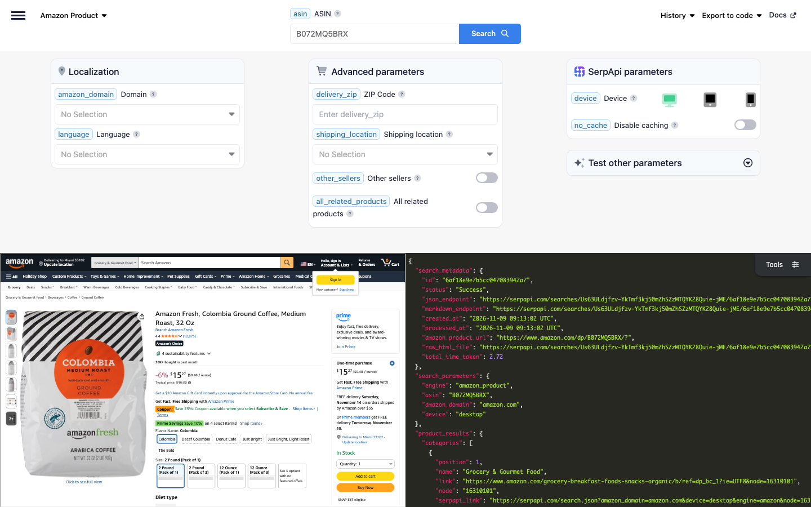

# Amazon Product Scraper

Scrape Amazon product pages with SerpApi's Amazon Product API. Look up a product by its ASIN and get its title, price, discounts, coupons, rating, review summary, images, variants, purchase options, sellers, delivery, About this item bullets, specifications, and related products.

## How to scrape Amazon product pages

Get the product page of a product with a simple GET request:

```text
https://serpapi.com/search?engine=amazon_product&asin=B072MQ5BRX&api_key=SERPAPI_API_KEY
```

- `asin` is the Amazon Standard Identification Number (ASIN) of the product, e.g., `B072MQ5BRX` for Amazon Fresh Colombia ground coffee. It's the 10-character ID after `/dp/` in the product's link, `https://www.amazon.com/dp/B072MQ5BRX/`, or the `asin` of a product in the [Amazon Search API](https://serpapi.com/amazon-search-api?utm_source=github_amazon_product_scraper) results.
- `api_key` is your SerpApi API key. Replace `SERPAPI_API_KEY` with it.
- `amazon_domain` sets the Amazon marketplace, e.g., `amazon.co.uk` or `amazon.de`, and `language` sets the language of the page, e.g., `es_US`.
- `delivery_zip` and `shipping_location` set the delivery area, e.g., `delivery_zip=10001` or `shipping_location=CA`.
- `other_sellers=true` adds the offers of other sellers.

[Register at SerpApi](https://serpapi.com?utm_source=github_amazon_product_scraper) to get your API key, and keep it private.

### Playground

Try the request live in the [SerpApi Playground](https://serpapi.com/playground?engine=amazon_product&asin=B072MQ5BRX&utm_source=github_amazon_product_scraper).

[](https://serpapi.com/playground?engine=amazon_product&asin=B072MQ5BRX&utm_source=github_amazon_product_scraper)

## Code examples

The code examples read your API key from the `SERPAPI_API_KEY` environment variable:

```bash
export SERPAPI_API_KEY="SERPAPI_API_KEY"
```

Each example gets the product page of Amazon Fresh Colombia ground coffee and prints its title, price, and rating, followed by the bullet points of its About this item section.

### curl integration

Send the request with curl, which prints the full JSON response:

```bash
curl --get https://serpapi.com/search \
 --data-urlencode engine="amazon_product" \
 --data-urlencode asin="B072MQ5BRX" \
 --data-urlencode api_key="$SERPAPI_API_KEY"
```

### JavaScript integration

Install the [SerpApi JavaScript library](https://github.com/serpapi/serpapi-javascript) and set your project to use ES modules:

```bash
npm install serpapi
npm pkg set type=module
```

Create an `index.js` file:

```javascript
import { getJson } from "serpapi";

const results = await getJson({
  engine: "amazon_product",
  api_key: process.env.SERPAPI_API_KEY,
  asin: "B072MQ5BRX",
});

const product = results.product_results;
console.log(product.title, product.price, product.rating);
for (const feature of results.about_item ?? []) {
  console.log(feature);
}
```

Run it with `node index.js`.

### Python integration

Install the [SerpApi Python library](https://github.com/serpapi/serpapi-python):

```bash
pip install serpapi
```

Create a `main.py` file:

```python
import os
import serpapi

client = serpapi.Client(api_key=os.getenv("SERPAPI_API_KEY"))
results = client.search({
    "engine": "amazon_product",
    "asin": "B072MQ5BRX",
})

product = results["product_results"]
print(product["title"], product.get("price"), product.get("rating"))
for feature in results.get("about_item", []):
    print(feature)
```

Run it with `python main.py`.

### Ruby integration

Install the [SerpApi Ruby library](https://github.com/serpapi/serpapi-ruby):

```bash
gem install serpapi
```

Create a `main.rb` file:

```ruby
require "serpapi"

client = SerpApi::Client.new(engine: "amazon_product", api_key: ENV.fetch("SERPAPI_API_KEY"))
results = client.search(asin: "B072MQ5BRX")

product = results[:product_results]
puts "#{product[:title]} #{product[:price]} #{product[:rating]}"
results.fetch(:about_item, []).each do |feature|
  puts feature
end

client.close
```

Run it with `ruby main.rb`.

### PHP integration

Install the [SerpApi PHP library](https://github.com/serpapi/serpapi-php):

```bash
composer require serpapi/serpapi-php
```

Create an `index.php` file:

```php
<?php
require 'vendor/autoload.php';

use SerpApi\Client;

$client = new Client(getenv('SERPAPI_API_KEY'), 'amazon_product');
$results = $client->search([
  'asin' => 'B072MQ5BRX',
]);

$product = $results->product_results;
echo $product->title . ' ' . ($product->price ?? '') . ' ' . ($product->rating ?? '') . PHP_EOL;
foreach ($results->about_item ?? [] as $feature) {
  echo $feature . PHP_EOL;
}
```

Run it with `php index.php`.

### Go integration

Create a Go module and install the [SerpApi Go library](https://github.com/serpapi/serpapi-golang):

```bash
go mod init example.com/product
go get github.com/serpapi/serpapi-golang
```

Create a `main.go` file:

```go
package main

import (
	"fmt"
	"os"

	"github.com/serpapi/serpapi-golang"
)

func main() {
	setting := serpapi.NewSerpApiClientSetting(os.Getenv("SERPAPI_API_KEY"))
	setting.Engine = "amazon_product"
	client := serpapi.NewClient(setting)

	results, err := client.Search(map[string]string{
		"asin": "B072MQ5BRX",
	})
	if err != nil {
		panic(err)
	}

	product, _ := results["product_results"].(map[string]interface{})
	fmt.Println(product["title"], product["price"], product["rating"])
	features, _ := results["about_item"].([]interface{})
	for _, feature := range features {
		fmt.Println(feature)
	}
}
```

Run it with `go run .`.

### Rust integration

Create a Cargo project and add the [SerpApi Rust library](https://github.com/serpapi/serpapi-rust) and Tokio:

```bash
cargo new product && cd product
cargo add serpapi tokio --features tokio/full
```

Replace `src/main.rs` with:

```rust
use serpapi::serpapi::Client;
use std::collections::HashMap;
use std::env;

#[tokio::main]
async fn main() -> Result<(), Box<dyn std::error::Error>> {
    let mut default = HashMap::new();
    default.insert("api_key".to_string(), env::var("SERPAPI_API_KEY")?);
    default.insert("engine".to_string(), "amazon_product".to_string());
    let client = Client::new(default)?;

    let mut parameter = HashMap::new();
    parameter.insert("asin".to_string(), "B072MQ5BRX".to_string());

    let results = client.search(parameter).await?;
    let product = &results["product_results"];
    println!(
        "{} {} {}",
        product["title"].as_str().unwrap_or_default(),
        product["price"].as_str().unwrap_or_default(),
        product["rating"]
    );
    if let Some(features) = results["about_item"].as_array() {
        for feature in features {
            println!("{}", feature.as_str().unwrap_or_default());
        }
    }
    Ok(())
}
```

Run it with `cargo run`.

### Other programming languages

Official libraries are also available for [Java](https://github.com/serpapi/serpapi-java), [.NET](https://github.com/serpapi/serpapi-dotnet), [Swift](https://github.com/serpapi/serpapi-swift), and [C++](https://github.com/serpapi/serpapi-cpp). See [SerpApi integrations](https://serpapi.com/integrations?utm_source=github_amazon_product_scraper) for setup guides, or use a simple GET request from any programming language.

### Errors

Failed requests return an HTTP error status and a JSON body with an `error` message. The most common are `401` for an invalid API key, `400` for a missing required parameter such as `asin`, and `429` when you exceed your hourly throughput limit or run out of searches. See [API status and error codes](https://serpapi.com/api-status-and-error-codes?utm_source=github_amazon_product_scraper) for the full list.

## Output formats: JSON and Markdown

Choose structured JSON for applications or Markdown for LLMs and AI agents:

- JSON is the default output and is useful when you need individual result fields.
- Add `output=md` to receive Markdown instead, which is more token-efficient.

Markdown is plain text, not JSON: YAML front matter with the search metadata, followed by the details of the product as lists and tables, one section per part of the product page. Read the response body as text instead of parsing it.

| Client | Markdown request |
|--------|------------------|
| curl | `--data-urlencode output="md"` |
| Python | `client.search({..., "output": "md"})` |
| PHP | `$client->md([...])` |
| Rust | `client.md(parameter).await?` |

If your SDK doesn't have a Markdown helper yet, send a plain HTTP request with `output=md` and read the body as text. Learn more about [Markdown output](https://serpapi.com/markdown-output?utm_source=github_amazon_product_scraper).

## Amazon Product API parameters

See the [Amazon Product API documentation](https://serpapi.com/amazon-product-api?utm_source=github_amazon_product_scraper) for more details.

| Name | Description | Requirement |
|------|-------------|-------------|
| **Search query** | | |
| `asin` | The Amazon Standard Identification Number (ASIN) of the product (e.g., `B072MQ5BRX`). It's the 10-character ID after `/dp/` in the link of the product, or the `asin` of the product in the Amazon Search API results. | Required |
| **Localization** | | |
| `amazon_domain` | The Amazon domain to use. Defaults to `amazon.com`. See [Amazon domains](https://serpapi.com/amazon-domains?utm_source=github_amazon_product_scraper) for supported domains. | Optional |
| `language` | The language of the product page, as a locale in `<language>_<REGION>` format (e.g., `en_US` or `es_US` on `amazon.com`, `ja_JP` on `amazon.co.jp`). See [Amazon languages](https://serpapi.com/amazon-languages?utm_source=github_amazon_product_scraper) for supported languages. | Optional |
| **Advanced parameters** | | |
| `delivery_zip` | The ZIP or postal code of the delivery area. | Optional |
| `shipping_location` | The country to ship to, as a two-letter country code (e.g., `GB`, `CA`). | Optional |
| `other_sellers` | Set to `true` to include the offers of other sellers in `other_sellers`. | Optional |
| `all_related_products` | Set to `true` to get all the items in `related_products` and `related_product_sections`, not just the first page. The response takes longer. | Optional |
| **SerpApi parameters** | | |
| `engine` | Set to `amazon_product`. | Required |
| `api_key` | Your private SerpApi API key. | Required |
| `device` | Set to `desktop` (default), `tablet`, or `mobile`. | Optional |
| `no_cache` | Set to `true` to request fresh results instead of using the one-hour cache. Can't be combined with `async`. | Optional |
| `async` | Set to `true` for later retrieval through the [Searches Archive API](https://serpapi.com/search-archive-api?utm_source=github_amazon_product_scraper). Can't be combined with `no_cache` or used with Ludicrous Speed enabled. | Optional |
| `zero_trace` | Enterprise only. Set to `true` to skip storing search parameters, files, and metadata on SerpApi servers. | Optional |
| `output` | Set to `json` (default), `html` for the raw HTML retrieved, or `md` for Markdown. | Optional |
| `json_restrictor` | Limit the JSON response to the fields you need. See the [JSON Restrictor](https://serpapi.com/json-restrictor?utm_source=github_amazon_product_scraper) documentation. | Optional |

## Available data on Amazon product pages (JSON response)

`product_results` has the main details of the product, and the other top-level keys hold the sections of the product page, such as `purchase_options`, `about_item`, and `product_details`. The field guides below describe the possible fields and their types; they aren't literal API responses.

### What you get depends on the product

Some fields appear only when the product page shows them:

| Product | Fields |
|---------|--------|
| A product with variants, such as sizes or flavors | `variants` and `variant_combinations`, with the ASIN of each variant |
| A product on sale or with a coupon | `old_price`, `discount`, `coupons`, and `promotions` |
| A product without a featured offer | No `price`, `stock`, or `purchase_options`, and `link` points to the offers of all sellers. Add `other_sellers=true` to get them in `other_sellers` |
| A product in several formats, such as a book | `prices`, with the price of each format |
| A book | `author`, `author_link`, `format`, `contributors`, `product_features`, `about_the_author`, and `editorial_reviews` |
| Food and other products with ingredients | `item_ingredients` and `important_information` |

Variants, bought-together items, and related products have a `serpapi_link` to their own product page. `categories[].serpapi_link` searches the category with the [Amazon Search API](https://serpapi.com/amazon-search-api?utm_source=github_amazon_product_scraper), and `coupons[].serpapi_amazon_promotion_link` gets the coupon's promotion page with the [Amazon Promotion API](https://serpapi.com/amazon-promotion-api?utm_source=github_amazon_product_scraper).

### Product details

`product_results` describes the product:

```json
{
  "product_results": {
    "asin": "String - ASIN of the product, e.g., B072MQ5BRX",
    "title": "String - Title of the product",
    "description": "String - Description of the product",
    "link": "String - Link to the product on Amazon",
    "link_clean": "String - Link to the product without tracking parameters, e.g., https://www.amazon.com/dp/B072MQ5BRX/",
    "serpapi_link": "String - SerpApi link to the product page",
    "brand": "String - Brand line, as displayed, e.g., Brand: Amazon Fresh or Visit the Apple Store",
    "author": "String - Author of a book, e.g., Andy Weir",
    "author_link": "String - Link to the author's page on Amazon",
    "format": "String - Format of a book, e.g., Hardcover",
    "contributors": "Array[Object] - Contributors of a book, each with name, link, and role, e.g., Author",
    "categories": [
      {
        "position": "Integer - Position in the category breadcrumb, starting at 1",
        "name": "String - Name of the category, e.g., Grocery & Gourmet Food",
        "link": "String - Link to the category on Amazon",
        "node": "String - Amazon browse node ID of the category, e.g., 16310101",
        "serpapi_link": "String - SerpApi link to the products in the category"
      }
    ],
    "tags": "Array[String] - Tags of the product, e.g., Vegan",
    "badges": "Array[String] - Badges of the product, e.g., Amazon's Choice or #1 Best Seller",
    "thumbnail": "String - Link to the main image",
    "thumbnails": "Array[String] - Links to the full-size images of the product",
    "rating": "Float - Average rating, e.g., 4.4",
    "reviews": "Integer - Number of reviews, e.g., 12875",
    "bought_last_month": "String - Purchases in the past month, as displayed, e.g., 30K+ bought in past month",
    "variants": [
      {
        "title": "String - Name of the variant dimension, e.g., Flavor Name",
        "items": [
          {
            "position": "Integer - Position of the variant, starting at 1",
            "asin": "String - ASIN of the variant",
            "name": "String - Name of the variant, e.g., Colombia",
            "selected": "Boolean - Whether the variant is the requested product",
            "serpapi_link": "String - SerpApi link to the product page of the variant"
          }
        ]
      }
    ],
    "variant_combinations": [
      {
        "dimensions": "Object - Value of each variant dimension, keyed by dimension, e.g., flavor: Colombia and size: 2 Pound (Pack of 1)",
        "asin": "String - ASIN of the combination, when it's available",
        "serpapi_link": "String - SerpApi link to the product page of the combination",
        "unavailable": "Boolean - Present when the combination isn't available on Amazon"
      }
    ]
  }
}
```

### Price, coupons, and delivery

The price, coupons, promotions, delivery, and stock of the featured offer are also in `product_results`:

```json
{
  "product_results": {
    "price": "String - Price, as displayed, e.g., $15.27",
    "extracted_price": "Float - Price as a number, e.g., 15.27",
    "max_price": "String - Upper bound when Amazon shows a price range, e.g., $35.99",
    "price_unit": "String - Price per unit, e.g., $0.48 / ounce",
    "extracted_price_unit": "Float - Price per unit as a number, e.g., 0.48",
    "old_price": "String - Price before the discount, e.g., $16.32",
    "extracted_old_price": "Float - Price before the discount as a number, e.g., 16.32",
    "discount": "String - Discount, e.g., -6%",
    "save_with_coupon": "String - Extra savings, e.g., Save an extra 25% on your first Subscribe and Save order.",
    "coupons": [
      {
        "text": "String - Text of the coupon, e.g., Save 25%: Coupon available when you select Subscribe & Save.",
        "discount": "String - Discount of the coupon, e.g., 25%",
        "shop_items_link": "String - Link to the items eligible for the coupon",
        "serpapi_amazon_promotion_link": "String - SerpApi link to the promotion page of the coupon",
        "terms_link": "String - Link to the terms of the coupon"
      }
    ],
    "promotions": [
      {
        "type": "String - Type of promotion: coupon, subscribe_save, promo_code, card, prime, volume, or offer",
        "text": "String - Text of the promotion, e.g., Prime Savings Save 10%",
        "discount_percent": "Number - Discount in percent, e.g., 10",
        "discount": "String - Money-off discount, e.g., AED 12.52",
        "minimum_purchase": "String - Minimum purchase, e.g., AED100",
        "code": "String - Promo code to enter at checkout",
        "eligibility": "String - Who qualifies, e.g., Prime members or Subscribe & Save",
        "provider": "String - Provider of the discount, e.g., Amazon",
        "link": "String - Link to the items eligible for the promotion"
      }
    ],
    "offers": "Array[String] - Other offers, e.g., Prime Savings Save 10% on 4 select item(s)",
    "snap_ebt_eligible": "Boolean - Whether SNAP EBT is accepted",
    "delivery": "Array[String] - Delivery dates and options, e.g., FREE delivery Saturday, November 14 on orders shipped by Amazon over $35",
    "stock": "String - Availability, e.g., In Stock"
  }
}
```

### Purchase options and other sellers

`purchase_options` has one object per buying option, keyed by its type, e.g., `buy_new`, `buy_used`, `subscribe_and_save`, or `single_offer`. The keys of `features` depend on the product, e.g., `shipper_seller`, `returns`, `payment`, `gift_options`, or `subscription`. `prices` lists the formats of a product, such as the Kindle, Hardcover, and Audiobook editions of a book, and `other_sellers` lists the offers of other sellers when you set `other_sellers=true`:

```json
{
  "purchase_options": {
    "buy_new": {
      "caption": "String - Caption of the option, e.g., One-time purchase",
      "price": "String - Price, e.g., $15.27",
      "extracted_price": "Float - Price as a number, e.g., 15.27",
      "price_unit": "String - Price per unit, e.g., $0.48 / ounce",
      "old_price": "String - Price before the discount, e.g., $32.00",
      "discount": "String - Discount, e.g., -40%",
      "delivery": "Array[String] - Delivery dates and options",
      "stock": "String - Availability, e.g., In Stock",
      "features": {
        "returns": {
          "text": "String - Text of the feature, e.g., FREE refund/replacement until Jan 31, 2027",
          "details": {
            "heading": "String - Heading of the details",
            "content": "String - Text of the details"
          },
          "link": {
            "text": "String - Text of the link, e.g., See return policy",
            "link": "String - Link to more information"
          }
        }
      }
    }
  },
  "prices": [
    {
      "position": "Integer - Position of the format, starting at 1",
      "title": "String - Format, e.g., Kindle, Hardcover, or Audiobook",
      "price": "String - Price, e.g., $14.99",
      "extracted_price": "Float - Price as a number, e.g., 14.99",
      "description": "String - Note about the format, e.g., Available instantly",
      "condition": "String - Condition, e.g., NEW or USED",
      "link": "String - Link to the product page of the format"
    }
  ],
  "other_sellers": [
    {
      "position": "Integer - Position of the offer, starting at 1",
      "sold_by": "String - Name of the seller",
      "ship_from": "String - Name of the shipper",
      "seller_feedback": "String - Feedback of the seller, e.g., 91% positive over last 12 months",
      "rating": "Float - Rating of the seller, e.g., 4.5",
      "reviews": "Integer - Number of seller ratings, e.g., 113514",
      "link": "String - Link to the seller's page on Amazon",
      "price": "String - Price, e.g., $200.22",
      "extracted_price": "Float - Price as a number, e.g., 200.22",
      "delivery": "Array[String] - Delivery dates and options"
    }
  ]
}
```

### About the item and product details

`about_item` has the bullet points of the About this item section. The keys of `item_specifications` and `product_details` depend on the product, e.g., `coffee_roast_level` for coffee or `isbn_13` for a book, and some details are arrays of strings, e.g., `in_the_box`:

```json
{
  "about_item": "Array[String] - Bullet points of the About this item section, e.g., 100% Arabica coffee grown in Colombia",
  "item_specifications": {
    "...": "String - Specification, keyed by name, e.g., color: White or impedance: 24 ohm"
  },
  "product_details": {
    "asin": "String - ASIN of the product",
    "manufacturer": "String - Manufacturer, e.g., Apple",
    "item_model_number": "String - Model number, e.g., MTJV3LL/A",
    "product_dimensions": "String - Dimensions and weight, e.g., 5.5 x 3.5 x 8.5 inches; 2 pounds",
    "item_weight": "String - Weight, e.g., 2 pounds",
    "date_first_available": "String - Date the product was first available, e.g., April 23, 2024",
    "in_the_box": "Array[String] - Contents of the box",
    "best_sellers_rank": [
      {
        "text": "String - Rank in a category, e.g., #57 in Our Brands (See Top 100 in Our Brands)",
        "extracted_rank": "Integer - Rank as a number, e.g., 57",
        "link": "String - Link to the Best Sellers list of the category",
        "link_text": "String - Text of the link, e.g., See Top 100 in Our Brands"
      }
    ],
    "rating": "Float - Average rating, e.g., 4.4",
    "reviews": "Integer - Number of reviews, e.g., 12875",
    "...": "String - Other details, keyed by name, e.g., publisher: Ballantine Books"
  },
  "product_features": "Array[Object] - Features of a book, each with position, title, e.g., Print length, and text, e.g., 496 pages",
  "item_ingredients": "Array[String] - Ingredients, e.g., Ground 100% Arabica coffee beans.",
  "important_information": [
    {
      "title": "String - Title of the section, e.g., Safety Information, Ingredients, Directions, or Legal Disclaimer",
      "text": "String - Text of the section"
    }
  ]
}
```

### Reviews

`reviews_information.summary` has the AI-generated summary of the reviews, the topics customers mention, and the percentage of each star rating. When the product page shows individual reviews, they're in `authors_reviews`:

```json
{
  "reviews_information": {
    "summary": {
      "text": "String - AI-generated summary of the reviews",
      "insights": [
        {
          "title": "String - Topic customers mention, e.g., Quality",
          "sentiment": "String - Sentiment of the mentions: positive, negative, or mixed",
          "mentions": {
            "total": "Integer - Number of mentions, e.g., 1400",
            "positive": "Integer - Number of positive mentions, e.g., 1066",
            "negative": "Integer - Number of negative mentions, e.g., 338"
          },
          "summary": "String - Summary of the mentions",
          "examples": "Array[Object] - Excerpts of reviews, each with position, snippet, and link"
        }
      ],
      "customer_reviews": {
        "5 star": "Integer - Percentage of 5-star ratings, e.g., 71",
        "4 star": "Integer - Percentage of 4-star ratings, e.g., 15",
        "3 star": "Integer - Percentage of 3-star ratings, e.g., 7",
        "2 star": "Integer - Percentage of 2-star ratings, e.g., 2",
        "1 star": "Integer - Percentage of 1-star ratings, e.g., 5"
      }
    },
    "authors_reviews": "Array[Object] - Reviews on the product page, each with position, title, text, rating, date, author, verified_purchase, and helpful_votes, e.g., 7 people found this helpful"
  }
}
```

### Other sections

These sections appear when the product page has them:

| Key | Contents |
|-----|----------|
| `bought_together` | Products frequently bought together, with `asin`, `title`, `thumbnail`, `price`, `stock`, and `serpapi_link` |
| `related_products` | Related products, with `asin`, `title`, `badges`, `rating`, `reviews`, `price`, and `serpapi_link`. Set `all_related_products=true` to get all of them |
| `related_product_sections` | Carousels of related products, each with a `title`, e.g., Similar items that may deliver to you quickly, and its `items` |
| `compare_with_similar` | Products in the comparison chart, with `asin`, `title`, `price`, `rating`, and the compared features, e.g., `chip` or `case` |
| `sponsored_brands` | Sponsored brands, with `name`, `headline`, `image`, `brand_logo`, and `link` |
| `videos` | Videos of the product, with `title`, `link`, `thumbnail`, `duration`, `vendor`, and `date` |
| `similar_product_videos` | Videos of similar products, with `title`, `link`, `thumbnail`, `duration`, and `vendor` |
| `product_description` | Sections of the product description, with `title`, `text`, `image`, and `features` |
| `sustainability_features` | Climate Pledge Friendly details, with a `summary` and `features`, each `certified_by` an organization, e.g., Rainforest Alliance |
| `about_the_author` | Authors of a book, with `name`, `link`, `description`, and `thumbnail` |
| `editorial_reviews` | Editorial reviews of a book, with `title`, e.g., Amazon.com Review, and `description` |
| `protection_plan` | Protection plans offered with the product, with `asin`, `title`, `price`, and `link` |

## AI agents and no-code

### MCP

Give AI agents and assistants an Amazon product page tool with the hosted [SerpApi MCP server](https://github.com/serpapi/serpapi-mcp) at `https://mcp.serpapi.com/mcp`.

Claude Code:

```bash
claude mcp add --transport http serpapi https://mcp.serpapi.com/mcp --header "Authorization: Bearer $SERPAPI_API_KEY"
```

Codex, which reads the key from `SERPAPI_API_KEY`:

```bash
codex mcp add serpapi --url https://mcp.serpapi.com/mcp --bearer-token-env-var SERPAPI_API_KEY
```

Other MCP clients:

```json
{
  "mcpServers": {
    "serpapi": {
      "type": "http",
      "url": "https://mcp.serpapi.com/SERPAPI_API_KEY/mcp"
    }
  }
}
```

The server's engine catalog includes the `amazon_product` engine, and its `serpapi://engines/amazon_product` resource describes the parameters. Ask your agent to get the product page of an Amazon product with the `amazon_product` engine. The resulting tool call looks like this:

```json
{
  "name": "search",
  "arguments": {
    "params": {
      "engine": "amazon_product",
      "asin": "B072MQ5BRX"
    }
  }
}
```

See the [MCP integration guide](https://serpapi.com/integrations/mcp?utm_source=github_amazon_product_scraper) for more clients and self-hosting.

### CLI

Get Amazon product pages from your terminal or from AI agent workflows with the [SerpApi CLI](https://github.com/serpapi/serpapi-cli):

```bash
brew tap serpapi/homebrew-tap
brew install serpapi-cli
```

The CLI picks up `SERPAPI_API_KEY` from your environment. You can also run `serpapi login` to save a key.

```bash
serpapi search engine=amazon_product asin=B072MQ5BRX
serpapi search engine=amazon_product asin=B072MQ5BRX --fields "product_results.title,product_results.price,product_results.rating,about_item"
serpapi search engine=amazon_product asin=B072MQ5BRX output=md
```

### No-code tools

Use SerpApi APIs without writing code:

- [NoCodeSerpApi](https://nocodeserpapi.com/)
- [SerpApi with n8n](https://serpapi.com/blog/tag/n8n/)
- [SerpApi with Make](https://serpapi.com/blog/tag/make/)
- [More integrations](https://github.com/serpapi/serpapi-integrations/)

## Use cases

- Track the price, discount, coupons, and stock of your products and competing products.
- Monitor ratings, review summaries, and Best Sellers Rank over time.
- Compare the offers of other sellers on the same product.
- Build product catalogs with images, variants, descriptions, and specifications.
- Map each variant of a product, such as a size or flavor, to its ASIN.
- Give AI agents and RAG pipelines detailed product information.

## Related scrapers

- [Amazon Scraper](https://github.com/serpapi/amazon-scraper): search products and find their ASINs
- [Amazon Promotion Scraper](https://github.com/serpapi/amazon-promotion-scraper): promotion and coupon pages
- [Google Shopping Scraper](https://github.com/serpapi/google-shopping-scraper): products and prices from Google Shopping

## Resources

- [Amazon ASIN Lookup API: Find and Fetch Product Details](https://serpapi.com/blog/amazon-asin-lookup-api/)
- [Scrape Amazon Product Data (complete 2026 tutorial)](https://serpapi.com/blog/scrape-amazon-product-data-tutorial/)

## Contact

Feel free to reach out at [contact@serpapi.com](mailto:contact@serpapi.com).
